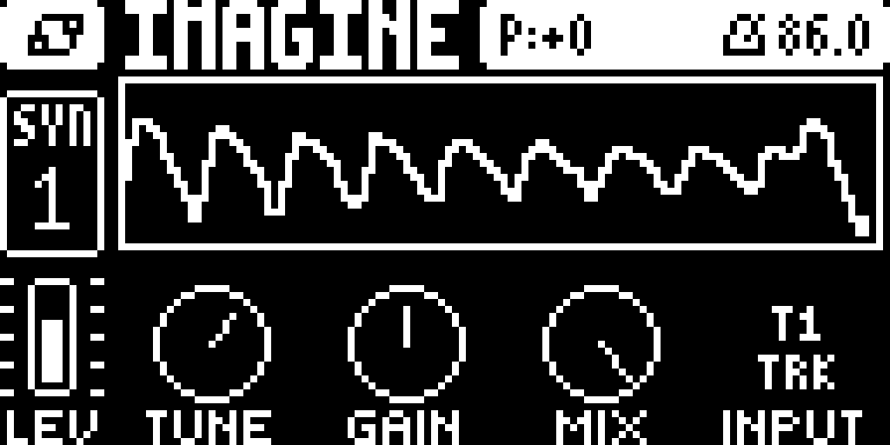

# FlexBus 1.0

**FlexBus** routes the Elektron Digitone mk1 / Keys and Digitakt mk1 audio
inputs—or their internal tracks—into a track, with a low-CPU pitch shifter and
an oscilloscope on the machine page.

*A FlexBus SYN1 page: INPUT T1, TUNE +7, the routed track in the scope. The
panel is rendered from the machine's layout; the status bar and left rail are
from a digiemu stock-page capture; the waveform is an example.*

## Downloads

| device | file | needs |
|---|---|---|
| Digitone mk1 / Keys, OS 1.44 | `flexbus-1.0-digitone-flexbus.elemod` | core-dn1 4.0 + machines 0.2 |
| Digitakt mk1, OS 1.54 | `flexbus-dt-1.0-digitakt-flexbus.elemod` | core 4.0 + machine-pages 1.1 |

SHA-256 checksums are in `SHA256SUMS.txt`.

## Install

Build a custom OS with [elekloader](https://github.com/irpina/elekloader) and
send it with Elektron Transfer.

1. In elekloader, select the matching stock OS file (Digitakt 1.54 or
   Digitone 1.44).
2. Install the core and companion `.elemod` files for the device, then the
   matching FlexBus `.elemod`.
3. Tick them, check for no conflicts, build the `.syx`, and send it with
   Transfer.
4. Keep the build to your own unit: it contains Elektron's firmware.

**Recovery:** hold **FUNC** while powering on, choose the OS upgrade entry
(**TRIG 4** on the Digitone), and send the stock `.syx` with Transfer's legacy
OS upgrade mode. The bootloader is never touched.

## Controls

### Digitone mk1 / Keys (SYN1)

| knob | |
|---|---|
| E **TUNE** | -24..+24 semitones |
| F **GAIN** | 0..127, 64 = unity |
| G **MIX** | dry/wet of the shifter |
| H **INPUT** | L, R, L+R, T1, T2, T3, T4 (seven zones) |

The scope above the dials shows the selected input. The input cell shows the
current source over `EXT`/`TRK`.

### Digitakt mk1 (SRC page)

| knob | |
|---|---|
| A **TUNE** | -24..+24 semitones |
| B | blank |
| C **SCOPE** | the input's oscilloscope |
| D | blank; no sample browser |
| E **INPUT** | L, R, L+R, T1..T8 |
| F **MIX** | dry/wet, 63 = full wet |
| G | blank |
| H **GAIN** | 0..127, 64 = unity |

## Notes

- One bus per track. The track must be triggered; its AMP envelope gates the
  bus. Selecting the FlexBus track itself is silence (no feedback loop).
- Internal tracks are tapped **post-machine, pre-filter**, one block late: the
  source track's own FILT/AMP/FX are not in the tap; the FlexBus track's chain
  is.
- The pitch shifter is a two-tap delay sweep with smoothstep fades and a short
  correlation at the splice. It measured -24..+24 at 1 kHz within 0.8% in the
  m68k bench; one shifted bus costs about 5,100 instructions/block.
- Digitone: the status bar and left rail in the image are a stock digiemu
  capture; the FlexBus content is a panel rendering. The waveform is an
  example.
- **Status:** Digitone 1.0 is hardware-tested by the user. Digitakt 1.0 is
  built, linted and bench-tested; not yet hardware-tested.

## Licence

GPL-2.0-or-later. The pitch shifter follows digineighbor; the drawing helpers
follow DRUM+ (both GPL-2.0-or-later). The Digitone page text uses the stock
fonts. This is an unofficial mod, not affiliated with or endorsed by Elektron.
Custom firmware is at your own risk. No Elektron firmware is included in this
repository.
