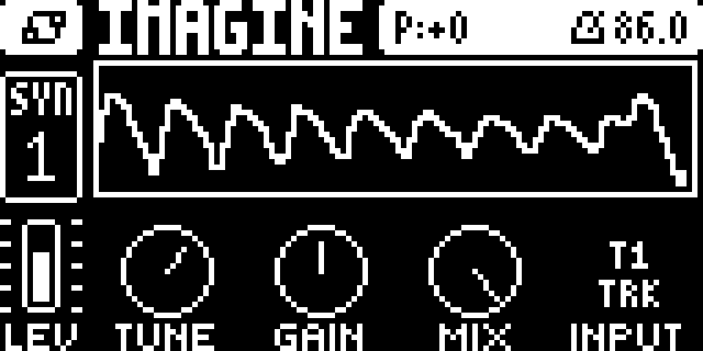

# Flex+ 1.1

Flex+ routes the Digitone and Digitakt audio inputs, or their internal tracks,
into a track, with a low-CPU pitch shifter and an oscilloscope on the machine
page.



## Files

| device | file | needs |
|---|---|---|
| Digitone mk1 / Keys, OS 1.44 | `flexbus-1.0-digitone-flexbus.elemod` | core-dn1 4.0 + machines 0.2 |
| Digitakt mk1, OS 1.54 | `flexbus-dt-1.0-digitakt-flexbus.elemod` | core 4.0 + machine-pages 1.1 |

SHA-256:

```
38BAF8714F725AF8D74EC433469DCB8579812821421CD91FC1D2B61DAA05778F  flexbus-1.0-digitone-flexbus.elemod
C5065BDED1CC8A824DDBA3A38B265485C164297ED993C595DFB0ABB1A31107CE  flexbus-dt-1.0-digitakt-flexbus.elemod
```

Only the regular Flex+ elemods are published. The FAST AUDIO Digitakt
prototype is not part of this release. The elemod filenames keep the machine
revision `1.0`; this is the Flex+ `1.1` release.

## Changes since 1.0

- Internal-track tap moved to `ev_render_out`, **post-filter and post-AMP**.
  A track selecting itself is silent.
- Scope bars are taller and mirrored around DC 0, with full positive and
  negative amplitude.
- Scope capture always advances; when audio render stops, the UI tick
  zero-fills the visible track so old samples scroll out.
- Source-need mask skips internal copies when no Flex+ track uses them.
- DSP and UI budget reduced; one shifted bus is about 4,246 instructions/block.
- Flex+ has four playable parameters only: TUNE, GAIN, MIX, INPUT. Performance
  gestures are not part of this release.

## What it does

- **Inputs:** external L, R, L+R; or the internal tracks (T1..T4 on the
  Digitone, T1..T8 on the Digitakt).
- **TUNE:** -24..+24 semitones, two-tap delay-sweep shifter.
- **GAIN** and **MIX** (shifter dry/wet).
- **Scope:** full-width on the Digitone, the A-D top row of the Digitakt SRC
  page (display only).
- The selected input replaces the track's sample/voice and then goes through
  the track's filter, AMP envelope, level and FX as usual. One bus per track;
  trigger it to open it; selecting itself is silence.

## Install

Build an OS with [elekloader](https://github.com/irpina/elekloader) from your
own stock OS: install the core and companion for the device, then the matching
Flex+ `.elemod`, and send the `.syx` with Elektron Transfer. Recovery is the
normal stock-OS path: hold **FUNC** while powering on, choose OS upgrade
(**TRIG 4** on the Digitone), send the stock `.syx`. The bootloader is never
touched.

## Status

Normal Flex+ Digitakt and Digitone builds are linted and bench-tested. The
current scope revision still needs hardware verification.

GPL-2.0-or-later. Unofficial; not affiliated with or endorsed by Elektron.
